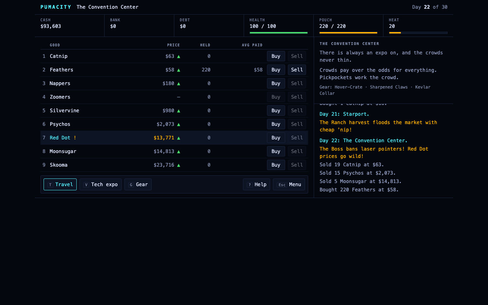

# PumaCity

**Buy low, sell high, and keep one step ahead of the Watchers.** A
puma-flavoured trading game in the spirit of *Dope Wars*, set on the streets of
PumaCity. You start with $1,500 and owe Casey Benton, The Boss, $8,000 at
10% a day. Ride the
markets across seven districts, gear up, and survive whatever is waiting when
you arrive.

Inspired by *Dope Wars* (John E. Dell, 1984). The trade goods are cat-themed
stand-ins; Skooma and Moonsugar are borrowed from *The Elder Scrolls*
(Bethesda), and The Vault nods to *Fallout*'s shelters. Everything here is
original text and code.

## Play

<https://greykit.com/games/pumacity/>

One `index.html`: no build step, no dependencies, no network at play time.
Saves stay in your browser's `localStorage`.



### How a run goes

- **Pick a length** (30, 60 or 90 days) and a name.
- **Every trip takes a day.** Each district has its own scenery behind the
  terminal. Prices roll fresh at each stop, one or two goods are out of
  stock, and a headline sometimes sends one good's price wild.
- **Read the market.** The *vs usual* column says whether each price is a
  bargain, cheap, fair, steep or sky-high for that good. The Held column
  shows what you paid and how today's price compares.
- **The debt compounds 10% a day.** Pay it down at PVN Tower. Go eight days
  without a real payment (at least 10% of what you owe) and The Boss sends
  her goons.
- **On the last day you cash out.** The Boss collects what you owe, and
  anything still in your pouch is worth nothing. Score = cash + bank − debt.
  Top ten per run length, kept locally.

### The city

| Place | What's special |
|---|---|
| Market Plaza | Start here. Downtown's open-air mall; tourists pay a premium for luxury goods. The outfitter: pouches, weapons, the Kevlar Collar, Sneaky Mittens, Shades. |
| PVN Tower | Casey Benton's tower: a theater at ground level, a nightclub above it, her office in the penthouse. Borrow and repay; Skooma sells high. |
| The Vault | A vault kept for PumaCity's leadership in case of war, run as a bank meanwhile. Money in it is safe and earns 1% a day. |
| The Ranch | An old horse ranch turned grow fields. Cheap 'nip, and the Watchers rarely come out this far (heat cools faster). |
| Starport | Where the ship lands, trading with other ports. Moonsugar and Skooma come in cheap. Hover-Crate and Mech-Claws. |
| The Convention Center | By the starport, a new event every week. Everything sells high. Pickpockets. The Pawphone. |
| Suburbs | Cul-de-sacs of Casey's rentals. The vet patches you up. |

**Goods**, cheapest first: Catnip, Feathers, Nappers, Zoomers, Silvervine,
Psychos, Red Dot, Moonsugar, Skooma.

**Encounters** roll when you arrive:
- **The Watchers.** They come more often, and in bigger numbers, the more
  heat you carry.
- **Rival dealers.** Some offer a deal; some just jump you.
- **Casey Benton.** She names a bribe to make your heat go away, or quietly
  buys your Skooma.
- **The Boss's goons.**
- **Strays** selling gear cheap.
- **Muggers**, and the odd stash in a drainpipe.

Against the Watchers or a rival crew you can **run, fight** (with a weapon) or
**give up**. Every choice shows its cost before you pick it: your odds of
getting away, what a failed run spills, and exactly what giving up loses.

### Controls

| Key | |
|---|---|
| `1`–`9`, `↑` `↓` | select a good |
| `B` / `S` | buy / sell it: the quantity opens under the good (`M` for the most you can) |
| `A` | sell all: everything you carry that someone here is buying |
| `T`, then `1`–`7` | travel (the destinations open beside the market) |
| `E` | cash out on the last day; `E` again confirms |
| `V` | this place's shop or office (opens beside the market) |
| `R` `F` `U`, `Y` / `N` | encounters: run, fight, give up; accept or turn down an offer |
| `?` | how to play · `Esc` menu / close |

Encounter keys never share a letter with market keys, and an encounter ignores
input for a moment after it appears. A key you were already pressing in the
market can't answer it by accident. Everything is also a button, and the
layout works at phone width.

## How it's built

The rules are data plus a DOM-free engine, which sit between the
`// ===== @core-begin =====` and `// ===== @core-end =====` markers in
`index.html`. The screen below them only talks to the core through
`newGame`, `step(state, action)` and `waiting(state)`.

- **One way in.** `step` never modifies the state it is given. It returns the
  new state, the log lines the move produced, or a reason it refused. A
  refused move returns the input untouched.
- **The state is plain JSON, and it is the whole save.** Its randomness is one
  32-bit LCG whose state lives in `st.rng`, so a seed replays a run exactly.
- **Bots play through the same door.** They read the state and never advance
  the RNG.

### Checks

```
node tools/check-assets.js   # every file index.html references exists
node tools/check-all.js      # 54 named rule scenarios
node tools/sim.js 20         # bots play whole runs; invariants after every step
```

`tools/core.js` cuts the core block out of `index.html` and evaluates it, so
the checks run exactly the code the browser runs. CI runs all three on every
pipeline. Each check has been seen failing against a deliberately broken rule
before it was trusted. `check-all.js` refuses to pass with zero scenarios, and
`sim.js` refuses zero runs.

`sim.js` fails if:
- a run crashes, the engine refuses a bot's move, or a bot moves the RNG
- an invariant breaks: cash, bank or debt goes negative, the pouch goes over
  capacity, or health or heat leaves its range
- a run never ends
- the share of careful runs finishing in profit leaves its target band:
  55–95% at 30 days, at least 60% at 60 and 90. The bot knows every price
  band, so it's a strong player. The upper bound exists because the first
  economy let every run win.
- no reckless run ever dies

Figures for 20 runs per cell:

| Days | Bot | Profit | Deaths | Median score |
|---|---|---|---|---|
| 30 | careful | 14/20 | 0 | $200,677 |
| 30 | reckless | 19/20 | 0 | $210,946 |
| 60 | careful | 14/20 | 2 | $640,822 |
| 60 | reckless | 13/20 | 5 | $1,920,180 |
| 90 | careful | 16/20 | 1 | $3,304,987 |
| 90 | reckless | 12/20 | 6 | $2,485,918 |

### Debugging

`window.__PC` exposes the following:
- the live `state`
- `act(action)`
- `force('watchers' | 'rival' | 'boss' | 'goons' | 'stray' | 'mugging' | 'stash')`, which starts an encounter now
- `set(patch)`
- `bot(n)`, which lets the bot play `n` moves

### Deploying

Merging to `main` runs `.gitlab-ci.yml`: validate, then rsync to
`greykit.com/games/pumacity/` on DreamHost. The host key is pinned rather than
scanned, and `--delete-excluded` keeps `tools/` and `screenshots/` off the
live site.

## Other Puma games

[PumaRally](https://greykit.com/games/pumarally/) ·
[PumaTriage](https://greykit.com/games/pumatriage/) ·
[PumaHeart](https://greykit.com/games/pumaheart/) ·
[PumaTower](https://greykit.com/games/pumatower/) ·
[more](https://greykit.com/games/)

## Credits

Game design and code by shandower, with AI assistance from Claude.
Inspired by *Dope Wars* by John E. Dell. MIT licensed.
